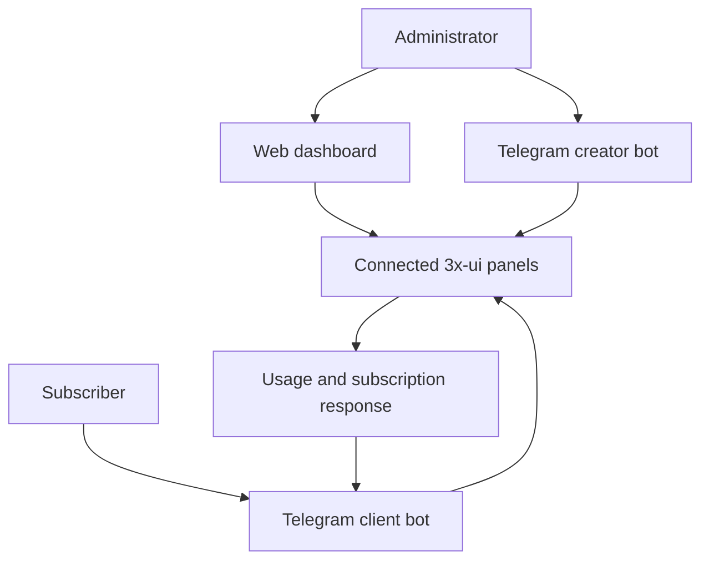

# GODSOFDATA · 3X-UI Dashboard

A project overview by Arunod Manohara.

[← Back to my portfolio](https://github.com/arunodmanoharaofficial)

## The problem

Managing several 3x-ui servers means switching between panels to inspect server health, manage clients, and answer subscriber questions about usage and expiry. This project brings those workflows into a central web interface with Telegram self-service.

## What the project brings together

- **Multi-server overview:** CPU, memory, and network telemetry for connected nodes.
- **Client management:** Search clients, inspect traffic, manage limits, and retrieve subscription information.
- **Provisioning workflows:** Package configuration and an administrator Telegram bot for creating clients.
- **Subscriber self-service:** A Telegram bot for usage, quota, expiry, and subscription retrieval.
- **Operations:** Backup and alert workflows, deployment scripts, and health verification.

This describes the project's documented capabilities, not a benchmark or an independent production audit.

## My contribution and engineering decisions

I maintain and evolve this dashboard and its bot integrations. Recent repository work includes the Next.js migration, restoring rich Telegram message formatting, and improving client deletion lookup.

### Challenge: identifying the right subscriber

Client names are not a dependable identifier across server workflows. Recent changes require a UUID or V2Ray link for the deletion flow and remove email/name deletion options. This makes the intended account identifier more explicit.

### Challenge: keeping bot output usable

Recent work restores rich Telegram message handling and table-card formatting so client information can be presented clearly in chat.

These are repository-backed implementation changes. No user-count, latency, or uptime claim is made here.

## Workflow overview

This diagram explains the documented workflows; it is not a screenshot of the application.

## Technology

| Layer | Technologies |
| --- | --- |
| Interface | Next.js, React, TypeScript, Tailwind CSS |
| Application services | Node.js, Express |
| Integrations | 3x-ui panels, Telegram Bot API |
| Deployment options | Docker Compose, PM2, Nginx on Linux |

## Design focus

**One place to manage multiple nodes.** The dashboard groups server and client workflows so routine administration can start from a single interface.

**Different workflows for administrators and subscribers.** The creator bot supports provisioning, while the subscriber bot focuses on usage and subscription information.

**Operations are part of the application.** Deployment health checks and backup workflows support ongoing maintenance alongside the user interface.

## Project status and source

The application source is private. This public overview shares the purpose, technology choices, and feature scope without publishing source code, credentials, server addresses, subscriber information, or operational configuration.

Live screenshots are not included because they may contain client or infrastructure details. A future visual walkthrough should use synthetic demo data.

## Discuss the project

[Email contact@arunod.us](mailto:contact@arunod.us) · [LinkedIn](https://www.linkedin.com/in/arunod-manohara-7613b6230/) · [Website](https://www.arunod.us)
